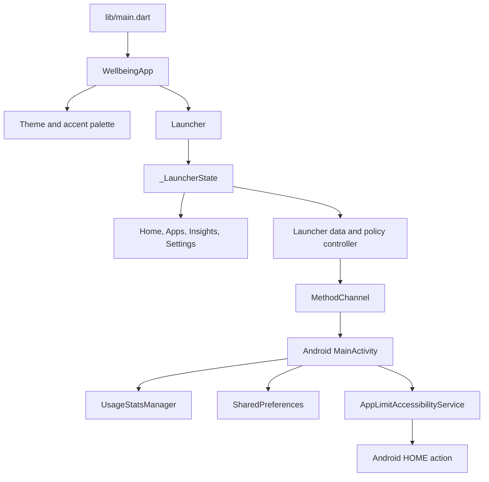

# App Structure and Architecture

This document describes how the Flutter launcher UI and its Android integration are organized, where app state lives, and how app usage policies are applied.

## At a glance

The project has three main layers:

1. **Flutter app shell and presentation** provide the theme, launcher tabs, dialogs, and settings.
2. **Flutter launcher state and controllers** load installed apps and preferences, handle navigation, and check policies before launch.
3. **Android platform integration** queries Android app and usage information, persists preferences, launches apps, and enforces policies while another app is foregrounded.



## Source tree

```text
lib/
├── main.dart
├── app/
│   └── wellbeing_app.dart
├── launcher/
│   ├── launcher.dart
│   ├── launcher_state.dart
│   ├── data_controller.dart
│   ├── theme_styles.dart
│   ├── main_view.dart
│   ├── navigation.dart
│   ├── home_view.dart
│   ├── apps_view.dart
│   ├── app_policy_dialog.dart
│   ├── insights_view.dart
│   ├── settings_view.dart
│   └── promise_dialog.dart
├── models/
│   ├── app_policy.dart
│   └── installed_app.dart
├── services/
│   └── launcher_channel.dart
└── theme/
    ├── accent_palette.dart
    ├── launcher_theme.dart
    └── launcher_theme_mode.dart

android/app/src/main/
├── AndroidManifest.xml
├── kotlin/com/example/digital_wellbeing_launcher/
│   ├── MainActivity.kt
│   └── AppLimitAccessibilityService.kt
└── res/
    ├── values/strings.xml
    └── xml/app_limit_accessibility_service.xml
```

## Flutter entry and app shell

### `lib/main.dart`

This is the Flutter entry point. It starts `WellbeingApp` and exports that widget to preserve the import used by the widget test.

### `lib/app/wellbeing_app.dart`

`WellbeingApp` owns appearance preferences:

- `themeMode` selects Light, Dark, or Black appearance.
- `accentIndex` selects one of the available accent palettes.
- `_loadThemeSettings` loads the saved values during startup.
- `_saveThemeSettings` updates the UI immediately and persists the new values through the Android channel.

The widget builds the current `ThemeData` and passes the selected mode and primary accent into `Launcher`. `Launcher` reports user selections back through callbacks; the app shell remains the source of truth for theme settings. Dark uses charcoal surfaces; Black keeps the deeper black surfaces from the original dark appearance.

### `lib/theme/`

- `accent_palette.dart` defines the names, seed colors, and preview icons for the Sage, Ocean, Plum, Terracotta, and Amber accents.
- `launcher_theme.dart` holds shared light-theme colors, app-initial tile colors, and `buildLauncherTheme`, which derives a Material 3 `ColorScheme` and surface colors from the selected accent and mode.
- `launcher_theme_mode.dart` defines the three appearance modes, storage values, labels, and backward-compatible loading for the former light/dark boolean.

Screen styles that need state-specific colors, such as the active accent and dark-mode surfaces, are in `launcher/theme_styles.dart`.

## Launcher state and screen organization

### `lib/launcher/launcher.dart`

This is the launcher library. It declares `Launcher`, imports the shared Flutter/model/theme dependencies, and lists its `part` files.

### Why the launcher uses `part` files

`_LauncherState` coordinates state shared by all launcher tabs: selected tab, installed apps, favorites, app policies, usage data, permissions, scroll/search state, and the focus timer. The screen and controller files are Dart `part`s of `launcher.dart`, implemented as extensions on `_LauncherState`.

This keeps those fields private and lets the related code access the same state without turning every callback and model into a large constructor API. Each part groups one responsibility; it does not create a separate widget tree or a second state store.

`launcher_state.dart` contains the state fields, initial loads, lifecycle observer, timer setup, disposal, and the `build` override. State updates from the parts go through `_updateState`, which delegates to Flutter's `setState` from within the `State` subclass.

### Screen and controller parts

| File | Responsibility |
| --- | --- |
| `main_view.dart` | Root scaffold, `PopScope`, top bar, page switcher, and tab content host. |
| `navigation.dart` | Horizontal swipe changes, alphabet slide scroller, and bottom navigation. |
| `home_view.dart` | Greeting/date, focus card, favorites, usage summary, setup prompts, and configured policy summaries. |
| `apps_view.dart` | Lazy installed-app list/grid, alphabet sections, search, favorite and policy controls, and app initials. |
| `app_policy_dialog.dart` | Per-app daily limit and 24-hour allowed-window editor. |
| `insights_view.dart` | Total daily use, most-used apps, and configured policy progress. |
| `settings_view.dart` | Light, Dark, and Black appearance selection plus accent selection. |
| `promise_dialog.dart` | The “A Promise to Yourself” policy-block dialog and Home date label helper. |
| `data_controller.dart` | Platform calls, state loading/saving, launcher/permission status, policy preflight, and app launch. |
| `theme_styles.dart` | Theme-aware colors and typography used by launcher parts. |

The Home favorites grid displays up to eight selected apps in two rows. Favorites are selected from the star controls in either Apps layout.

## Models

### `lib/models/installed_app.dart`

`InstalledApp` contains the launch label and package name returned by Android. The package name is used as the stable identifier for launching, favorites, usage, and policies.

### `lib/models/app_policy.dart`

`AppPolicy` contains optional per-app rules:

- `dailyLimitEnabled` and `dailyLimitMinutes` configure a daily use budget.
- `usageWindowEnabled`, `windowStartMinute`, and `windowEndMinute` configure allowed local-time hours.
- `isConfigured` reports whether either rule is active.
- `fromJson` and `toJson` convert between Flutter state and the JSON format stored natively. The serialized rule also includes its app package and label.

An equal start and end time represents an all-day window. A start later than the end represents a window that crosses midnight.

## Platform channel and persistence

### `lib/services/launcher_channel.dart`

Defines the single `MethodChannel` used by Flutter and `MainActivity`:

```text
com.example.digital_wellbeing_launcher/apps
```

### Android channel methods

`MainActivity.kt` implements these calls:

| Method group | Methods | Purpose |
| --- | --- | --- |
| Home role | `isDefaultHomeApp`, `requestHomeRole` | Check/request Android's default launcher role. |
| Installed apps | `getInstalledApps`, `launchApp` | Return distinct launchable apps and start an app by package name. App queries run on a single-thread executor. |
| Policies | `getAppPolicies`, `saveAppPolicies` | Read/write policy JSON and discard usage counters for apps whose daily limit was removed. |
| Favorites | `getFavoriteApps`, `saveFavoriteApps` | Read/write the selected package-name list. |
| Appearance | `getThemeSettings`, `saveThemeSettings` | Persist theme mode and accent index. Older installations with only the former dark boolean are mapped to Black. |
| Usage Access | `hasUsageAccess`, `openUsageAccessSettings`, `getAppUsageStats`, `getWeeklyUsageStats` | Check special access, open Android settings, and query today's or the week's per-package foreground durations. Usage queries run off the UI thread. |
| Enforcement service | `isEnforcementEnabled`, `openAccessibilitySettings`, `consumeEnforcementEvent`, `getDailyUsage` | Check service state, open its settings, retrieve a pending block notice, and read the service's own daily counters. |

These values are stored in Android `SharedPreferences` named `wellbeing_launcher_policies`, shared by the activity and accessibility service. This keeps app preferences local to the device.

## App launch and policy enforcement

The launch path has two checks:

1. The Flutter launcher calls `_launchPolicyFailure` before asking Android to launch the app.
2. The Android accessibility service enforces the policy while the app is foregrounded, if that service has been enabled.

### Before launch

`_launchPolicyFailure` first checks a configured allowed-hours window using local device time. For a daily limit, it requests fresh `UsageStatsManager` data when Usage Access is available. If that query is unavailable, it falls back to the accessibility service's locally accumulated usage and then to the latest in-memory usage value.

If the current time is outside the window or usage is at/above the configured limit, `_launchApp` shows the existing promise dialog and does not invoke `launchApp`. Otherwise it asks `MainActivity` to start the selected package.

### While an app is open

`AppLimitAccessibilityService.kt` listens for window-state/window changes. It does not request access to window contents (`canRetrieveWindowContent` is false). It tracks which package is foregrounded, accounts seconds for apps with an enabled daily limit, and checks the configured time window and accumulated limit. The daily counter is saved periodically and resets when the local date changes.

When a rule fails, the service writes a one-shot event containing the app label and reason, then calls Android's `GLOBAL_ACTION_HOME`. When the launcher resumes, Flutter consumes that event and displays the promise dialog.

The Usage Access permission and Accessibility service are separate Android settings. Usage Access supplies system usage metrics and a pre-launch daily-limit check. The Accessibility service supplies foreground policy enforcement and its own fallback usage counter.

## Usage metrics

`getAppUsageStats` queries `UsageStatsManager` from local midnight to the current time, and `getWeeklyUsageStats` queries the historical daily usage for each day across the week. Flutter stores the returned seconds-per-package maps and uses them in:

- the Home page total and most-used app summary;
- per-app usage labels in list and grid layouts;
- Insights total, everyday weekly usage graph, ranking bars, and daily-limit progress.

Metrics refresh at startup and when the launcher returns to the foreground. If Usage Access has not been granted, the UI indicates that access is needed instead of presenting the system metrics as available.

## Preferences and navigation behavior

- Light/Dark/Black mode and accent index are stored natively and reloaded by `WellbeingApp`. The top-bar appearance button cycles through all three modes; Settings offers direct selection.
- Favorite package names and app-policy JSON are stored natively and loaded by `_LauncherState`.
- The selected tab, app search, grid/list choice, and focus timer are session state in `_LauncherState`.
- The focus card starts/stops a local 25-minute countdown; it is separate from per-app daily budgets.
- `PopScope` prevents Android Back from finishing the launcher on Home; from another tab it returns to Home.
- A horizontal swipe moves among Home, Apps, Insights, and Settings. The bottom navigation provides direct tab selection.

## Validation

The widget smoke test lives at `test/widget_test.dart` and mocks the app MethodChannel. Run Flutter analysis with:

```sh
flutter analyze
```

Run the widget tests with:

```sh
flutter test
```

